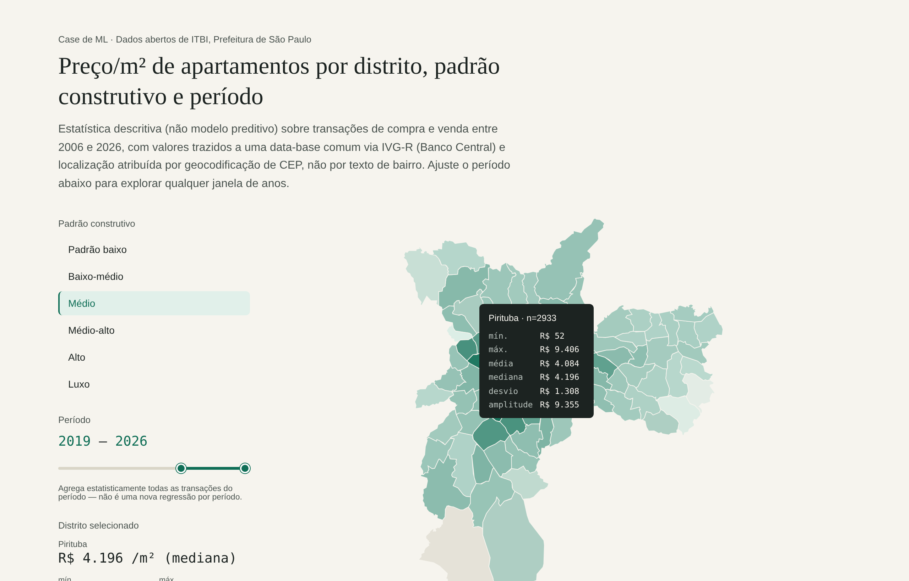

# itbi-sp-valor-m2

**Quanto vale o m² de um apartamento em São Paulo, por distrito e padrão construtivo, segundo 1,1 milhão de transações reais de ITBI (2006 a 2026)?**

Pipeline reprodutível que parte dos dados abertos de ITBI da Prefeitura de São Paulo, corrige o tempo pelo IVG-R (Banco Central), geocodifica por CEP,
estima o valor com um modelo hedônico e com uma camada de ML validada no tempo, e publica um **mapa coroplético interativo** (slider de período e estatísticas por distrito).


> Mapa interativo: abra [`docs/mapa_preco_m2_distrito_sp.html`](docs/mapa_preco_m2_distrito_sp.html) no navegador. Arquivo único, com dados e D3 embutidos (só as fontes vêm do Google Fonts).

## Resultado principal

Em teste temporal (jan/2025 a jun/2026, 99.649 vendas, modelo treinado só com o passado), o erro percentual absoluto mediano cai de **22,4% para 16,3%**
frente ao baseline hedônico por distrito (−27%), e de 18,7% para 16,3% (−13%) frente a um linear forte com CEP.
O ganho concentra-se nas classes altas:

| Padrão | 20 | 21 | 22 médio | 23 | 24 alto | 25 luxo | Global |
|---|---|---|---|---|---|---|---|
| Baseline (distrito + padrão) | 23,3 | 21,0 | 21,4 | 25,5 | 37,8 | 44,6 | 22,4 |
| ML (gradient boosting + recalibração) | 21,2 | 15,0 | 15,7 | 18,8 | 23,5 | 28,2 | **16,3** |

Detalhes, ablações, intervalos de predição e limitações: [`docs/ML.md`](docs/ML.md).
Achados sobre dados e decisões: [`CHANGELOG.md`](CHANGELOG.md), [`docs/metodologia_correcao_ivgr.md`](docs/metodologia_correcao_ivgr.md), [`docs/metodologia_terrenos_2022.md`](docs/metodologia_terrenos_2022.md).

> Não substitui um laudo ABNT NBR 14653: é uma referência estatística baseada em valores *declarados* ao ITBI, com intervalo de 80% largo (±40% mediano).

## Pipeline

```
ITBI .xlsx (21 anos) ─► carregamento robusto + filtro apto/compra e venda ─► depuração (valor simbólico, área, data)
   ─► correção temporal IVG-R ─► CEP → lat/lon → distrito (96 polígonos) ─┬► mapa HTML (estatística por ano/distrito/padrão)
                                                                          ├► modelo hedônico (Huber) + diagnóstico de drift
                                                                          └► ML (HGB), validação temporal, intervalo conformal
```

## Como rodar

```bash
pip install -e ".[dev]"
pytest                                     # 17 testes
cp config.example.toml config.toml         # ajuste os caminhos, se precisar
itbi-sp base        --config config.toml   # monta a base (cache parquet por ano)
itbi-sp mapa        --config config.toml   # outputs/mapa_preco_m2_distrito_sp.html
itbi-sp diagnostico --config config.toml   # R² por era: o efeito de distrito não é estacionário
itbi-sp ml          --config config.toml   # experimento de ML, tabelas em outputs/
```

Os dados brutos não estão no Git; ver [`data/README.md`](data/README.md) (fontes, manifesto SHA-256).

## Estrutura

```
src/itbi_sp/
  config.py            colunas, padrões, parâmetros (decisões documentadas)
  carregamento.py      loader robusto (abas sem cabeçalho, cabeçalho mal rotulado, colunas extras)
  depuracao.py         funil de apartamento
  temporal.py          correção IVG-R
  geo.py               CEP → coordenadas → distrito (vetorizado)
  modelo_hedonico.py   baseline Huber + grade de preços
  diagnostico_temporal.py   drift do efeito de distrito entre eras
  ml.py / experimento_ml.py camada de ML
  mapa.py              mapa coroplético HTML autônomo
  pipeline.py / cli.py orquestração
  terreno/             fase exploratória anterior (terrenos, auditoria de valor simbólico)
tests/  docs/  data/
```

## Decisões que valem destacar

* **Terreno é inviável com ITBI bruto:** 94% dos registros "terreno" são unidades de empreendimentos ainda não individualizados no cadastro. Apartamento é o recorte limpo (96,7% de SQL exclusivo).
* **IVG-R e não IPCA:** entre 2015 e 2017 o índice do setor caiu enquanto a inflação geral subiu; corrigir por IPCA superestimaria comparáveis em 28% nesse intervalo.
* **O efeito de distrito não é estacionário.** Agrupar 21 anos *piora* o modelo (R² 0,565 contra 0,629 só com 2019+); o treino de produção usa 2019+. O ML também não resolve isso com 21 anos.
* **Validação temporal**, métricas **por classe** e intervalo com cobertura medida.

## Fontes e licenças

ITBI: dados abertos da Prefeitura de São Paulo. IVG-R: Banco Central do Brasil (SGS 21340). Limites de distrito: GeoSampa (via `codigourbano/distritos-sp`).
Coordenadas por CEP: dataset de terceiros no Kaggle (não redistribuído). Código sob licença MIT.

Autor: Carlo Yukio Nunes (engenheiro civil e cientista de dados).
